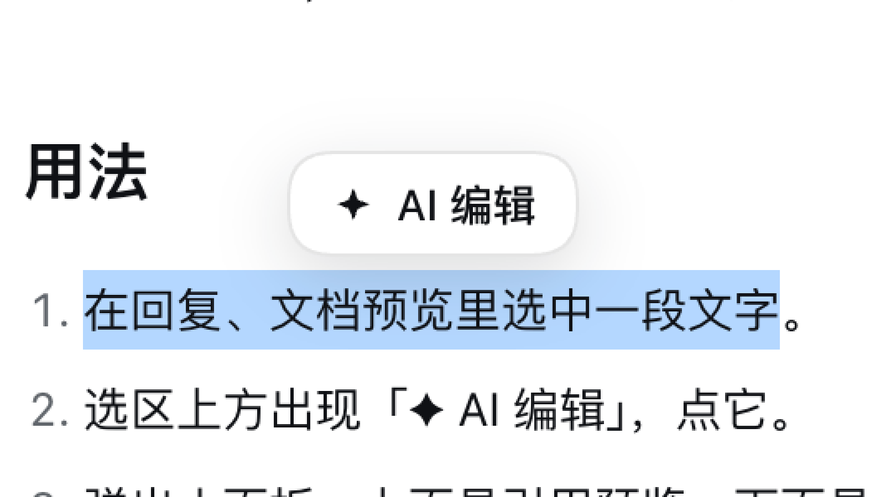
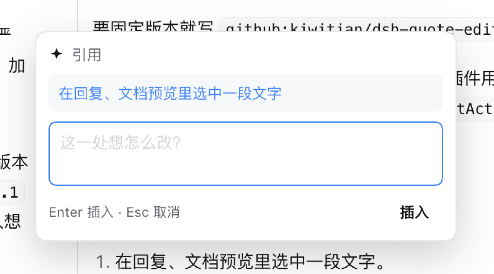

# 摘句 · dsh-quote-edit

> Quote text from a DeepSeek Harness reply or document into the composer, note what should change, and send several edits at once.
>
> 在 DeepSeek Harness 里选中文字，一键引用到输入框，写下这一处要改成什么；可以连着攒好几处，最后一次发出去。

在对话里改文字，麻烦的常常是描述「哪一段」。这个插件把描述换成引用：选中哪句就引用哪句，你的意见紧跟在后。

## 安装

在 DSH 的设置 → 插件 → 添加里填：

```
github:kiwitian/dsh-quote-edit
```

要固定版本就写 `github:kiwitian/dsh-quote-edit#v1.0.2`。装完刷新页面。

需要 DSH 0.2.x（桌面版或 `dsh web` 都行）。插件用的是 `shell.overlay`、`conversation.input.dock`
和输入框的 `InputActions`，版本差太远可能挂不上；挂不上时胶囊不出现，不会影响其他功能。

## 用法

1. 在回复或文档预览里选中一段文字，选区上方出现「✦ AI 编辑」。

   

2. 点它，弹出小面板：上面是引用预览，下面是输入框。

   

3. 写一句想怎么改，按 Enter（或点「插入」）。草稿里多出这样一行：

   ```
   【在回复、文档预览里选中一段文字】把这个文案调整一下
   ```

   

4. 接着选下一处，重复。所有引用都攒在同一条草稿里，最后一起发。

## 行为约定

- 一处引用占一行：`【原文】改动意见`。原文压成一行，超过 30 字截断加 `…`；收尾优先落在句末标点，其次词与词之间，最后才用逗号，只在末尾 10 个字里找位置，不会为一个大早的逗号砍掉半句。意见没写就只留 `【原文】`。
- 引用插在光标处，草稿原有内容不覆盖，一次可撤销。
- 输入框里选中的文字不会触发浮层；插件自己的浮层也不会。
- 没开会话（没有输入框）时不出现浮层，因为无处可插。
- 深色主题下浮层、按钮跟着变，不写死颜色。

## 实现

- 悬浮层挂在 `shell.overlay`：选区侦测、浮层定位、交互都在这里。
- `conversation.input.dock` 挂一个不可见入口，把 composer 的 `InputActions` 交给悬浮层。
- 插入只调用 `inputActions.captureInsertion()` + `inputActions.insertText(text, span)`，
  和官方语音输入用的是同一对接口：一次可撤销的纯文本编辑，不模拟键盘、不碰编辑器内部。
- 样式只用 `--dsw-alias-*` 主题变量。

## 卸载

设置 → 插件 → 已安装，停用或移除 `@kiwitian/dsh-quote-edit`。删掉本目录前先移除插件。

## License

MIT，见 [LICENSE](LICENSE)。
